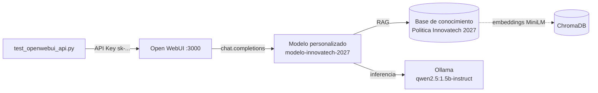

# Laboratorio RAG Parte 2 — Modelo personalizado en Open WebUI y consumo por API

**Estudiante:** Brayan Esmid Cruz Chate
**Actividad:** RAG básico con Open WebUI (parte 2)
**Repositorio base:** <https://github.com/FerchoRV/ejemplo-rag-openwebui>
**Fecha:** noviembre de 2026

---

## 1. Objetivo

Poner en marcha el laboratorio de RAG con **Ollama + Open WebUI**, reutilizar la
base de conocimiento creada en el **Lab 2** (`politica_innovatech_2027.txt`),
construir un **modelo personalizado** que la consuma y **verificar su consumo
desde código** con el SDK de OpenAI y una **API Key** de Open WebUI.

El flujo completo queda automatizado y es reproducible:



## 2. Requisitos

| Herramienta | Versión usada | Notas |
|---|---|---|
| Docker Desktop | 29.8.2 | Con WSL2 y al menos 4 GB de RAM para los contenedores |
| Python | 3.12 | El entorno virtual se crea con `py -3.12 -m venv .venv` |
| Ollama | contenedor `ollama/ollama:latest` | Modelo base `qwen2.5:1.5b-instruct` (~1 GB) |
| Open WebUI | `ghcr.io/open-webui/open-webui:v0.5.20` | Puerto local `3000` |
| Git | 2.52 | Para clonar y versionar |

## 3. Estructura del repositorio

```text
lab-rag-parte2-innovatech/
├── docker-compose.yml            # Ollama + Open WebUI
├── .env.example                  # Variables (API key, modelo, admin)
├── requirements.txt              # SDK OpenAI, dotenv, requests
├── test_openwebui_api.py         # Prueba de consumo del modelo (actividad)
├── evaluate_rag.py               # Evaluación opcional por lote (extra)
├── golden_dataset.jsonl          # 8 preguntas de evaluación (extra)
├── knowledge/
│   └── politica_innovatech_2027.txt   # Base de conocimiento del Lab 2
├── scripts/
│   ├── setup.ps1                 # Crea .venv e instala requirements
│   ├── start_lab.ps1             # Levanta el stack y hace el bootstrap
│   ├── stop_lab.ps1              # Detiene el stack
│   ├── setup.sh                  # Equivalente Unix
│   ├── bootstrap_openwebui.py    # Cuenta admin, API key, knowledge y modelo
│   └── capture_model_info.py     # Evidencia del modelo y de la recuperación
├── docs/
│   ├── GUIA-PASO-A-PASO.md       # Mapeo paso a paso de la actividad
│   └── INFORME.md                # Informe con resultados y conclusiones
├── evidence/
│   ├── terminal/                 # Salidas reales de terminal
│   └── capturas/                 # Capturas de Open WebUI
└── runs/                         # Resultados de evaluate_rag.py
```

## 4. Inicio rápido

### Windows (PowerShell)

```powershell
git clone <url-de-este-repo>
cd lab-rag-parte2-innovatech

# 1) Entorno virtual + dependencias
powershell -ExecutionPolicy Bypass -File scripts/setup.ps1

# 2) Stack + bootstrap (admin, API key, knowledge base y modelo)
powershell -ExecutionPolicy Bypass -File scripts/start_lab.ps1

# 3) Prueba de consumo por API
.\.venv\Scripts\python.exe test_openwebui_api.py
```

### Linux / macOS

```bash
python3 -m venv .venv && source .venv/bin/activate
pip install -r requirements.txt
cp .env.example .env
docker compose up -d
docker exec ollama-rag-lab ollama pull qwen2.5:1.5b-instruct
python scripts/bootstrap_openwebui.py
python test_openwebui_api.py
```

Al terminar, Open WebUI queda disponible en <http://localhost:3000> y el
modelo personalizado **`modelo-innovatech-2027`** en *Workspace → Models*.

## 5. Cómo se cumplió cada punto de la actividad

| # | Indicación | Evidencia |
|---|---|---|
| 1 | Clonar el repositorio de ejemplo | `repo-original/` clonado desde GitHub; el código base se adaptó en este repo |
| 2 | Entorno virtual con los requirements | `scripts/setup.ps1` + salida de `pip install` en `evidence/terminal/` |
| 3 | Ejecutar el lab y levantar Open WebUI | `docker compose up -d`; `docker ps` y `docker logs` en `evidence/terminal/` |
| 4 | Modelo personalizado con la base del Lab 2 | `scripts/bootstrap_openwebui.py`; captura en `evidence/capturas/` |
| 5 | Crear API Key | Generada por API y guardada en `.env` (nunca versionada) |
| 6 | Ajustar ID de modelo y variable de API Key | `.env` (`TARGET_MODEL`, `OPENWEBUI_API_KEY`) |
| 7 | Ejecutar `test_openwebui_api.py` | Salida completa en `evidence/terminal/` |
| 8 | Evidencias y repositorio público | Carpeta `evidence/` e historial Git del repo |

## 6. Resultados

> Los resultados de la ejecución real (latencia, respuestas y verificación del
> RAG) están en **[docs/INFORME.md](docs/INFORME.md)** y en `evidence/`.

Resumen:

- El modelo personalizado **`modelo-innovatech-2027`** responde usando la
  política interna 2027: monto del auxilio (`$245.000 COP`), código
  `#INV-CON-2027`, plazos, canales de reporte de incidentes y cifrado.
- Ante preguntas fuera del documento (por ejemplo, el horario de la cafetería),
  el modelo indica que la información no está en la política y recomienda
  consultar con Recursos Humanos.
- El consumo por API funciona con el endpoint compatible con OpenAI
  `http://localhost:3000/api` y una API Key `sk-...`.
- **Evaluación por lote (8 preguntas):** 0 errores de API, **100 %** de
  coincidencia de palabras clave, latencia promedio **5,31 s** (mediana 5,34 s).
- **Prueba de la actividad (3 preguntas):** saludo 10,49 s; auxilio 7,94 s;
  fuera de alcance 4,60 s.


## 7. Configuración relevante

- **Endpoint compatible OpenAI:** `http://localhost:3000/api`
  (el SDK agrega `/chat/completions`).
- **Modelo:** `modelo-innovatech-2027` (personalizado, `base_model_id =
  qwen2.5:1.5b-instruct`).
- **Knowledge:** `Politica Innovatech 2027`, con el archivo
  `politica_innovatech_2027.txt` indexado. La entrada en `meta.knowledge` debe
  incluir `"type": "collection"`; si solo se envía el `id`, Open WebUI 0.5.x
  busca una colección de archivo y no recupera contexto.
- **Plantilla RAG estricta:** el bootstrap configura
  `POST /api/v1/retrieval/query/settings/update` con una plantilla que obliga a
  responder solo con el contexto. La plantilla por defecto invita al modelo a
  usar su propio conocimiento cuando el dato no está, lo que produce
  alucinaciones con un modelo de 1.5 B.
- **Sin `params.system`:** se retiró el *system prompt* del modelo porque Open
  WebUI lo envía como opción `system` a Ollama y provocaba rechazos falsos. El
  comportamiento se controla únicamente con la plantilla RAG.
- **Generación de consultas desactivada:**
  `ENABLE_RETRIEVAL_QUERY_GENERATION=false` y
  `ENABLE_SEARCH_QUERY_GENERATION=false` para que la recuperación use la
  pregunta del usuario tal cual.
- Si el modelo o la knowledge no son visibles para el dueño de la API Key, el
  RAG no recupera contexto. En este repo el modelo se crea público y la API Key
  pertenece al administrador.

## 8. Notas y correcciones sobre el repo original

1. `requirements.txt` del repo original fija `openai==3.53.0`, versión que no
   existe en PyPI. Aquí se corrige a `openai>=1.60,<3`.
2. Se agrega `requests` porque el bootstrap crea la knowledge base, el modelo y
   la API Key por REST.
3. Se agrega `healthcheck` a Ollama para que Open WebUI no arranque antes de
   tiempo.
4. El modelo juez de `evaluate_rag.py` se adaptó de fitness a políticas internas.

## 9. Seguridad

- `.env` y `docker-compose.override.yml` están en `.gitignore`.
- La API Key se genera en tiempo de ejecución y **no** se versiona.
- Las credenciales de ejemplo (`Innovatech2027*`) son solo para un laboratorio
  local; cámbialas en cualquier despliegue real.

## 10. Licencia

MIT. Ver [LICENSE](LICENSE).
