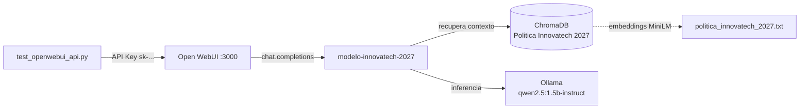

# Informe — Laboratorio RAG Parte 2

**Título:** Modelo personalizado con RAG en Open WebUI y consumo desde Python
**Estudiante:** Brayan Esmid Cruz Chate
**Asignatura:** Laboratorio de RAG
**Fecha:** noviembre de 2026
**Repositorio base:** <https://github.com/FerchoRV/ejemplo-rag-openwebui>

---

## 1. Resumen

Se montó un laboratorio local con **Ollama + Open WebUI** usando Docker Compose,
se reutilizó la base de conocimiento del Lab 2
(`politica_innovatech_2027.txt`) y se creó el modelo personalizado
**`modelo-innovatech-2027`** con esa knowledge vinculada. Finalmente se consumió
el modelo desde Python con el SDK de OpenAI y una **API Key** de Open WebUI
(`sk-...`), verificando que:

- responde con datos exactos de la política (monto del auxilio, código interno,
  plazos y canales de ciberseguridad, cifrado);
- **no inventa** cuando la pregunta está fuera del documento;
- el flujo completo es reproducible con scripts.

Resultado de la evaluación por lote (8 preguntas del dominio): **0 errores de
API, 100 % de coincidencia de palabras clave y 5,31 s de latencia promedio**.

## 2. Entorno utilizado

| Componente | Versión / detalle |
|---|---|
| Sistema operativo | Windows 11 (PowerShell) |
| Docker Desktop | 29.8.2, backend WSL2 |
| Python | 3.12.10 (entorno virtual `.venv`) |
| `openai` (SDK) | 2.54.0 |
| `python-dotenv` | 1.2.4 |
| `requests` | 2.34.2 |
| Ollama | contenedor `ollama/ollama:latest`, puerto `11434` |
| Open WebUI | `ghcr.io/open-webui/open-webui:v0.5.20`, puerto `3000` |
| Modelo base | `qwen2.5:1.5b-instruct` (1.5 B parámetros, ~986 MB, q4_K_M) |
| Embeddings | `sentence-transformers/all-MiniLM-L6-v2` (por defecto de Open WebUI) |
| Vector store | ChromaDB embebido en Open WebUI |

## 3. Arquitectura



El archivo de política se indexa en dos fragmentos (chunks). La recuperación
vectorial ocurre **del lado del servidor**: el cliente solo envía la pregunta y
Open WebUI inyecta el contexto recuperado en la plantilla RAG antes de llamar a
Ollama.

## 4. Ejecución realizada

### 4.1 Levantar el laboratorio

```powershell
docker compose up -d
docker ps
```

Contenedores resultantes:

```text
NAME             IMAGE                                   STATUS                    PORTS
open-webui-lab   ghcr.io/open-webui/open-webui:v0.5.20   Up (healthy)              0.0.0.0:3000->8080/tcp
ollama-rag-lab   ollama/ollama:latest                    Up (healthy)              0.0.0.0:11434->11434/tcp
```

Evidencia: `evidence/terminal/01-docker-compose-ps.txt`,
`evidence/terminal/02-docker-ps.txt`.

### 4.2 Crear knowledge, API Key y modelo personalizado

```powershell
.\.venv\Scripts\python.exe scripts\bootstrap_openwebui.py
```

Salida real (`evidence/terminal/06-bootstrap.txt`):

```text
[bootstrap] Sesion iniciada como admin@innovatech.local.
[bootstrap] Plantilla RAG estricta configurada (solo responde con el contexto).
[bootstrap] API Key guardada en .env (sk-...c47b1f)
[bootstrap] Base de conocimiento existente: Politica Innovatech 2027 (d85c1b5c-...)
[bootstrap] El documento ya esta indexado en la knowledge: politica_innovatech_2027.txt
[bootstrap] Modelo personalizado existente; actualizando: modelo-innovatech-2027
```

El modelo queda configurado así (evidencia:
`evidence/terminal/04-modelos-openwebui.txt`):

```text
id          : modelo-innovatech-2027
nombre      : Asistente Innovatech 2027
modelo base : qwen2.5:1.5b-instruct
temperatura : 0.0
knowledge   : [('Politica Innovatech 2027', 'd85c1b5c-...', 'collection')]
```

### 4.3 Consumo desde Python

```powershell
$env:PYTHONUTF8=1
.\.venv\Scripts\python.exe test_openwebui_api.py
```

Salida real (`evidence/terminal/05-test-openwebui-api.txt`):

| Pregunta | Respuesta del modelo | Latencia | Tokens (prompt/completion) |
|---|---|---|---|
| Hola, preséntate y dime qué asistencia brindas | “Asistente Innovatech 2027. Puedo responder preguntas sobre la Política Interna de Beneficios y Seguridad de Innovatech Colombia 2027…” | 10,49 s | 701 / 61 |
| Monto del auxilio y código interno | “El monto del auxilio de conectividad es de **$245.000 COP**. El código interno … es **#INV-CON-2027**.” | 7,94 s | 711 / 46 |
| Horario de la cafetería los sábados | “Esa informacion no esta en la Politica Interna 2027. Por favor consulta con Recursos Humanos.” | 4,60 s | 689 / 28 |

Las tres respuestas son correctas: dos recuperan datos del documento y la
tercera evita inventar información.

## 5. Evaluación por lote (extra)

Se ejecutó `evaluate_rag.py` sobre `golden_dataset.jsonl` (8 preguntas:
beneficios, vacaciones, ciberseguridad y una fuera de alcance):

```powershell
.\.venv\Scripts\python.exe evaluate_rag.py
```

```text
=== RESUMEN DE EVALUACIÓN ===
Casos totales    : 8
Errores HTTP/API : 0
Latencia prom.   : 5.31s | Mediana: 5.34s
Keywords OK      : 100.0%
```

Detalle por caso:

| Caso | Palabras clave | Respuesta |
|---|---|---|
| `aux_monto` | ✅ 245.000, COP | `$245.000 COP` |
| `aux_codigo` | ✅ #INV-CON-2027 | “El código interno … es #INV-CON-2027.” |
| `vac_dias` | ✅ 7 | “hasta un máximo de 7 días hábiles…” |
| `vac_aprobacion` | ✅ líder, Laura Martínez | “El líder de proyecto… la directora Laura Martínez dirige Recursos Humanos.” |
| `sec_plazo` | ✅ 2 horas | “plazo inferior a 2 horas…” |
| `sec_canal` | ✅ #sec-incidentes-urgente, 809 | “canal … Slack … extensión interna 809.” |
| `sec_cifrado` | ✅ AES-256, trimestral | “AES-256 con rotación trimestral…” |
| `fuera_alcance` | ✅ (sin claves) | Mensaje de que el dato no está en la política |

Resultados crudos: `evidence/terminal/08-evaluacion-detalle.jsonl` (copia del
archivo generado en `runs/`) y `evidence/terminal/07-evaluacion.txt`.

## 6. Evidencias

### Terminal (`evidence/terminal/`)

| Archivo | Contenido |
|---|---|
| `01-docker-compose-ps.txt` | Estado de los servicios del compose |
| `02-docker-ps.txt` | Contenedores, imágenes y puertos |
| `03-ollama-list.txt` | Modelos disponibles en Ollama |
| `04-modelos-openwebui.txt` | Modelos expuestos, configuración del modelo y recuperación vectorial |
| `05-test-openwebui-api.txt` | Salida completa de `test_openwebui_api.py` |
| `06-bootstrap.txt` | Creación/actualización de knowledge, API key y modelo |
| `07-evaluacion.txt` | Resumen de `evaluate_rag.py` |
| `08-evaluacion-detalle.jsonl` | Respuestas completas de los 8 casos evaluados |

### Capturas (`evidence/capturas/`)

| Archivo | Contenido |
|---|---|
| `01-workspace-modelos.jpeg` | *Workspace → Models* con “Asistente Innovatech 2027” |
| `02-workspace-conocimiento.jpeg` | *Workspace → Knowledge* con la colección “Politica Innovatech 2027” |
| `03-chat-rag-auxilio.jpeg` | Chat respondiendo el monto y el código, con la fuente citada |
| `04-chat-fuera-de-alcance.jpeg` | Chat rechazando una pregunta fuera del documento |

## 7. Problemas encontrados y soluciones

### 7.1 `openai==3.53.0` no existe

El `requirements.txt` del repositorio de ejemplo fija esa versión, que no está
publicada en PyPI. Se corrigió a `openai>=1.60,<3` y se agregó `requests` para
el bootstrap por REST.

### 7.2 El modelo respondía sin usar la knowledge

En Open WebUI 0.5.x, si `meta.knowledge` del modelo solo lleva `id`, el backend
busca una colección de **archivo** (`file-<id>`) y no la colección de la
knowledge, por lo que no recupera nada. La solución fue declarar la entrada con
`"type": "collection"`. Verificable en `evidence/terminal/04-modelos-openwebui.txt`.

### 7.3 La plantilla RAG por defecto induce a responder con conocimiento propio

La plantilla por defecto de la versión 0.5.20 dice, entre otras cosas, “si la
respuesta no está en el contexto pero la conoces, respóndela con tu propio
conocimiento”. Con un modelo de 1.5 B eso produce respuestas inventadas (por
ejemplo, “500.000 pesos” y código “123456”). Se reemplazó por una **plantilla
estricta** (`STRICT_RAG_TEMPLATE` en `scripts/bootstrap_openwebui.py`) que
obliga a responder solo con el contexto y a declarar cuando el dato no aparece.

### 7.4 `params.system` del modelo provoca rechazos falsos

Open WebUI envía `params.system` como opción `system` a Ollama. Con el modelo
pequeño, esa instrucción extra competía con la plantilla y hacía que algunas
preguntas **con** contexto correcto respondieran “el dato no está”. Se retiró
`system` de los parámetros del modelo; el comportamiento se controla solo con la
plantilla estricta. Tras el cambio, la evaluación pasó de 75 % a 100 % de
coincidencia de palabras clave.

### 7.5 Generación automática de consultas

Con modelos pequeños, la generación automática de consultas de recuperación
añadía ruido. Se desactivó con
`ENABLE_RETRIEVAL_QUERY_GENERATION=false` y
`ENABLE_SEARCH_QUERY_GENERATION=false`; la recuperación usa directamente la
pregunta del usuario.

### 7.6 Descarga de la imagen de Open WebUI

`docker pull` desde GHCR se quedaba bloqueado en este equipo. La imagen
`v0.5.20` se descargó con `crane` (plataforma `linux/amd64`) y se cargó con
`docker load`; el compose la reutiliza por etiqueta.

## 8. Conclusiones

1. Open WebUI + Ollama permiten construir un RAG funcional sin escribir el
   pipeline de recuperación: la knowledge se indexa y se inyecta como contexto.
2. La calidad final depende mucho de la **plantilla RAG**: la de por defecto
   favorece respuestas con conocimiento propio, inaceptable para políticas
   internas.
3. Un modelo de 1.5 B es suficiente para responder preguntas puntuales sobre un
   documento corto (100 % de acierto en el conjunto de 8 casos), con latencias
   de 4–8 s en CPU.
4. El endpoint compatible con OpenAI (`http://localhost:3000/api`) permite
   reutilizar el SDK oficial y una API Key `sk-...` sin cambios en el código del
   cliente.
5. Separar infraestructura (`docker-compose.yml`), datos (`knowledge/`) y
   automatización (`scripts/`) hace que el laboratorio sea reproducible con dos
   comandos.

## 9. Limitaciones y trabajo futuro

- El modelo base es pequeño: en preguntas ambiguas puede parafrasear o
  responder de forma incompleta. Con `qwen2.5:3b`/`7b` mejoraría la redacción
  sin cambiar el pipeline.
- El documento se indexó en solo dos chunks; con documentos largos conviene
  ajustar `RAG_CHUNK_SIZE`/`RAG_CHUNK_OVERLAP` y evaluar recuperación.
- No se usó un modelo juez (`JUDGE_MODEL` vacío); la evaluación mide latencia,
  errores y palabras clave. Activar un juez permitiría puntuar fidelidad 1–5.
- Las credenciales del `.env` son de laboratorio local y no deben reutilizarse.
